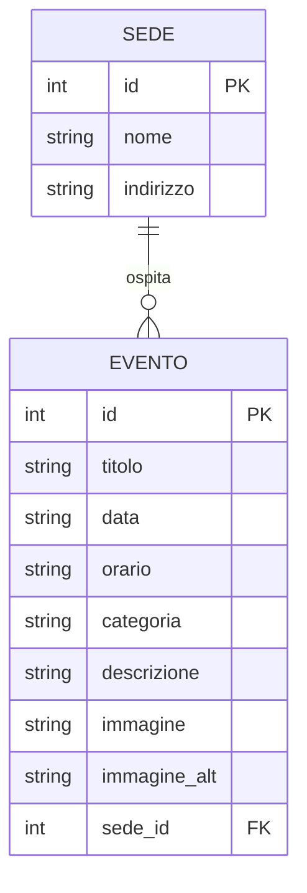

# Segnale — Scheda dati e schema

1. **Entità:** Sede ed Evento.
2. **Campi, tipi ed esempi:** nelle tabelle seguenti.
3. **Chiavi primarie:** id numerico univoco e stabile in ciascuna entità. Sede 1 ed Evento 1 sono record diversi: gli identificativi sono univoci nella propria entità.
4. **Relazione:** una sede può ospitare zero o più eventi; ogni evento del Programma ha una sede. Evento.sede_id fa riferimento a Sede.id.
5. **Quantità:** la versione finale ha sei eventi e tre sedi; la base fornisce due eventi (id 1 e 4) e una sede (id 1).
6. **Aggiornamento:** la redazione modifica i file JSON nella repository e pubblica le modifiche.
7. **Pagina:** Programma con schede degli eventi e nome della sede.

| Sede | Tipo JSON | Esempio |
| --- | --- | --- |
| id | numero | 1 |
| nome | testo | Officina Nord — Sede centrale |
| indirizzo | testo | Corso Duca degli Abruzzi 24, Torino |

| Evento | Tipo JSON | Esempio |
| --- | --- | --- |
| id | numero | 1 |
| titolo | testo | Lettere in movimento |
| data | testo, YYYY-MM-DD | 2026-06-12 |
| orario | testo, HH:MM | 10:00 |
| categoria | testo | Incontro |
| descrizione | testo | Come cambia un messaggio quando cambiano le lettere? |
| immagine | testo con percorso | assets/lettere-in-movimento.svg |
| immagine_alt | testo | Lettere geometriche disposte su una griglia |
| sede_id | numero, riferimento | 1 |

La data è una stringa nel JSON, visualizzata in italiano dalla pagina. Il percorso dell’immagine è relativo alla pagina Programma. Il testo alternativo proviene dal record.

Un sede_id inesistente è un dato da correggere: il testo Sede da definire evita che la pagina si interrompa, ma non rende valido il riferimento.
